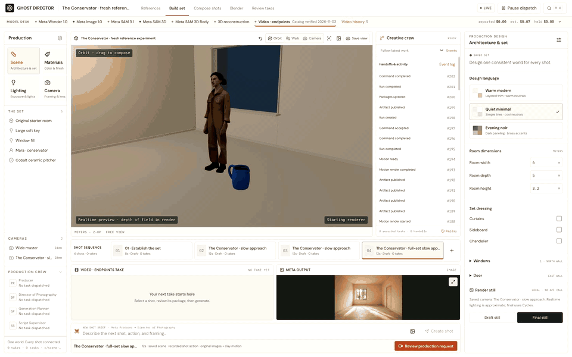
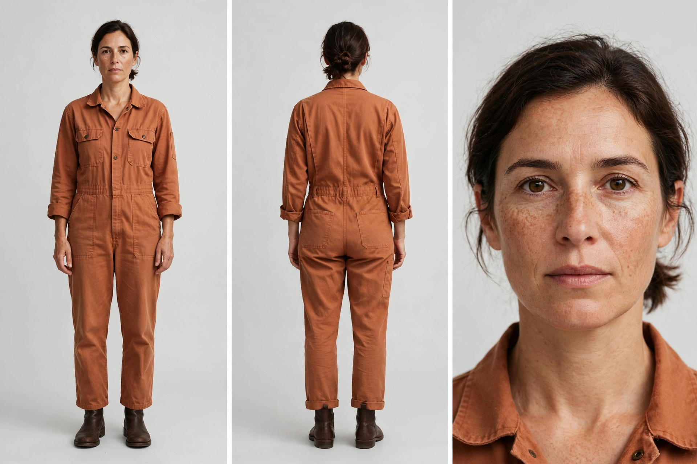
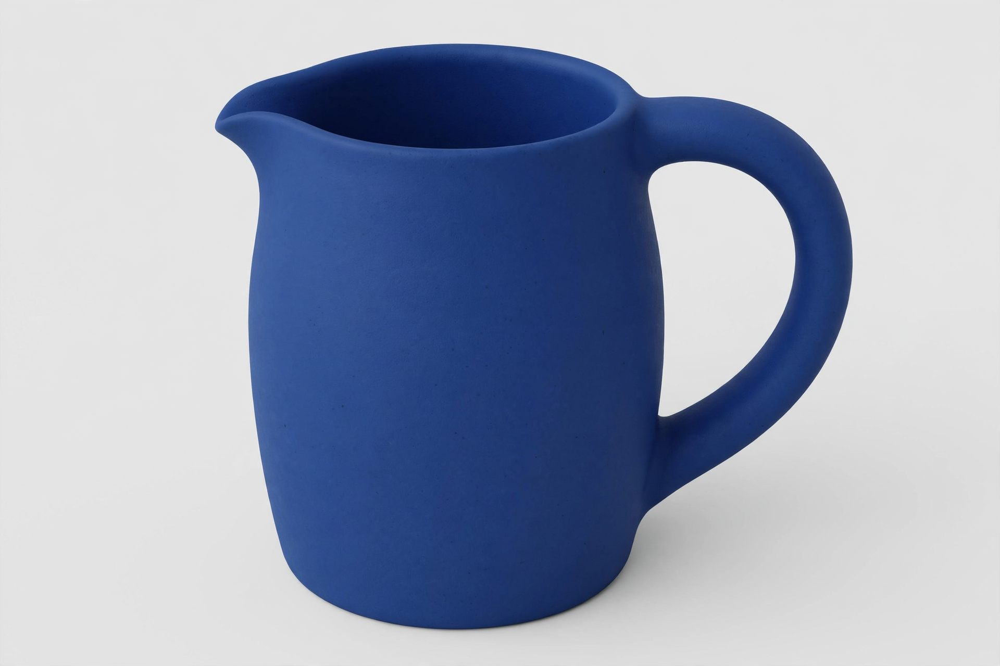
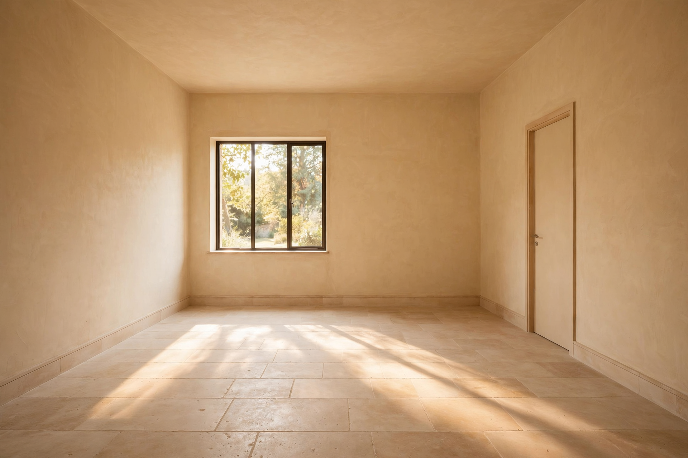
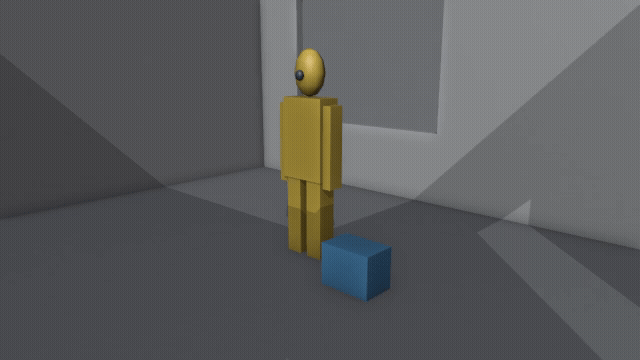
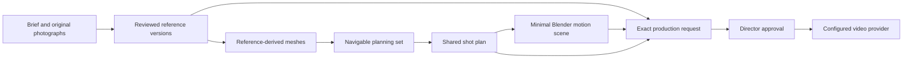

# Ghost Director

**A reference-first directing workspace: approve the look, inspect the set, plan the shot, review the exact generation request.**

Ghost Director connects photographic references, a navigable Three.js set and a synchronized Blender motion scene in one local web application. Meta image generation and hosted Meta SAM 3D provide original references and reference-derived geometry. Bounded reasoning roles assist planning and review; deterministic code owns scene revisions, validation, budgets and dispatch.

## See the workspace

[](docs/media/workspace-walkthrough.mp4)

**A real recording of the application.** This preview plays the full 65-second tour at 4.5× speed. It inspects completed work; the speed does not represent generation latency. [Watch the real-time MP4](docs/media/workspace-walkthrough.mp4) · [Full visual report and gallery](docs/SHOWCASE.md)

| Original character reference | Original prop reference | Original location reference |
| --- | --- | --- |
|  |  |  |

These three new Meta-generated images are the appearance source for **The Conservator** test. The character and prop were reconstructed with hosted Meta SAM 3D; the room was adapted locally. The tour shows the actual planning meshes and recorded review limitations beside these references.

| Actual Blender motion · current test | Generated prop film · earlier test |
| --- | --- |
| [](docs/media/conservator-blender-motion.mp4) | [](docs/media/earlier-bottle-film.mp4) |
| **12 seconds.** Real clay render from the shared shot plan. Technical proxies define movement; the original photos define appearance. | **4.04 seconds.** Separate prop-only experiment using a Meta reference and Blender motion. A separate renderer produced the film. Take unaccepted; scene fidelity unverified. |

**The Conservator has no final generated film.** The earlier bottle clip is separate evidence. [Inspect the comparisons, exact inputs and video limitations](docs/SHOWCASE.md). For a presentation with native video controls and chapter navigation, open the [hosted visual report](https://muratcankoylan.github.io/ghost-director/showcase/), served by GitHub Pages from `docs/`. No API keys are required to view the report.

## The production model



**Photographs define appearance. Blender defines motion.** A world screenshot never silently replaces an approved photograph in the reference-motion route.

## What you can use

| Workspace | Implemented behavior | Boundary |
| --- | --- | --- |
| References | Upload/generate character front/back/face, one location master and named prop states; approve immutable versions | Consistent image editing is not integrated; a contact sheet still needs inspection |
| Build set | Navigate, place reviewed assets, edit room dimensions, finishes, lights, windows and east/west door | Rectangular interiors; no automatic full-room reconstruction |
| Compare in world | Inspect an image-derived mesh beside its approved photographs and record geometry/material/identity findings | Manual review; static meshes, unseen surfaces and small details can be wrong |
| Compose shots | Save camera/blocking timelines and exact approved reference pins | Root transforms; no articulated acting/contact simulation |
| Blender | Actual task state, current/stale bindings, local motion/still renders, `.blend` and receipt access | Working subprocess integration; MCP is not implemented |
| Production review | Ordered original images, actual clay MP4, compiled prompt, coverage gaps and cost estimate | New paid dispatch requires approval of that exact package |
| Runtime evidence | Provider jobs, outputs, role prompts, handoffs, revision history and replay | No simulated crew activity or fabricated progress |

The local **Conservator** experiment generated three new photographs and two real SAM 3D meshes for an estimated **$0.07**. The meshes are reviewed and placed for static wide-shot planning, with coarse facial/hand detail and unverified material fidelity explicitly recorded. The shared plan produced a real **12-second Blender motion clip** and a compiled package containing five approved images, that clip and the shot prompt. No final film has been generated for this scene. Curated documentation images and videos are included; the experiment database, full media bundle and provider payloads are excluded. A fresh installation starts with an empty procedural set. [Evidence and limitations](docs/FRESH-EXPERIMENT.md)

## Quick start

Requirements: Python 3.11+, [uv](https://docs.astral.sh/uv/), Node 26+, npm, and Blender for creating/rendering a set. Install FFmpeg/ffprobe for video validation. The tested local Blender version is 5.2.3; other versions require verification.

```sh
git clone https://github.com/muratcankoylan/ghost-director.git
cd ghost-director
uv sync --frozen --extra dev
npm --prefix web ci
npm --prefix web run build
cp .env.example .env.local
```

Set `GHOST_BLENDER` in `.env.local` if Blender is not on PATH. Keep `STUDIO_ALLOW_LIVE_CALLS=0` for the local workflow.

```sh
uv run python tools/ghost_doctor.py
uv run ghost-director --env-file .env.local bootstrap
uv run ghost-director --env-file .env.local serve --port 8000
```

Open **http://127.0.0.1:8000/**. Bootstrap creates a new empty procedural room without calling a model. It refuses to overwrite an existing production. This checkout is the supported distribution; a standalone wheel does not contain the web application and all tooling.

For frontend development, run `npm --prefix web run dev` in another terminal and open http://127.0.0.1:5173/. Vite proxies API calls to port 8000.

## Model services and spending

Keys are server-side in ignored `.env.local`; never put them in frontend variables or commits.

| Variable | Purpose |
| --- | --- |
| `MODEL_API_KEY` | Meta reasoning, image generation and segmentation |
| `FAL_KEY` | Hosted Meta SAM 3D Objects and the supported image-plus-motion video route |
| `OPENROUTER_API_KEY` | Optional validated legacy video routes |
| `STUDIO_ALLOW_LIVE_CALLS` | Explicit local switch for paid requests; default `0` |
| `GHOST_BLENDER` | Blender executable path |
| `GHOST_PRODUCTION_ROOT` | Optional isolated local production directory |
| `GHOST_STUDIO_ROOT` | Optional trusted Studio OS checkout for external role guidance |

The standalone app includes original generic Producer, DP, Generation Planner and Script Supervisor contracts. It requires no private Studio OS access. If external Studio OS is explicitly configured, its role guidance is loaded with recorded hashes and its own terms; invalid configuration fails instead of silently switching context. The bundled contracts do not reproduce imported Studio OS skills or claim equivalent evaluated quality.

Model IDs are dated capability pins, not an automatic promise to select the newest release. Technical provenance preserves actual provider/model names. A supported API shape is not a guarantee of current account access or output quality. See [provenance](docs/PROVENANCE.md).

Before a paid experiment, inspect the proposed inputs, rates and budget. Unknown remote outcomes retain their reservations and do not authorize automatic resubmission. The local budget ledger does not discover spending made outside this application.

## Test and contribute

```sh
uv run python -m pytest tests/ghost_director
npm --prefix web test
npm --prefix web run build
```

Most tests use deterministic fixtures or mocked providers; they do not spend money. Real Blender checks and observed API evidence are identified separately. External Studio OS integration tests are skipped when that optional checkout is absent; standalone role contracts have their own tests. [Testing](docs/TESTING.md) · [Contributing](CONTRIBUTING.md)

## License and release boundaries

Original Ghost Director application code and original release documentation are **MIT licensed**. Dependencies, external guidance and generated media have separate terms; inclusion does not grant a new asset license. [License](LICENSE) · [Provenance](docs/PROVENANCE.md) · [Local security boundary](SECURITY.md)

Built by Muratcan Koylan (https://x.com/muratcan) and Ata Koylan (https://x.com/atakoylanai)

Feel free to reach out for any questions and collaboration inquiries.
