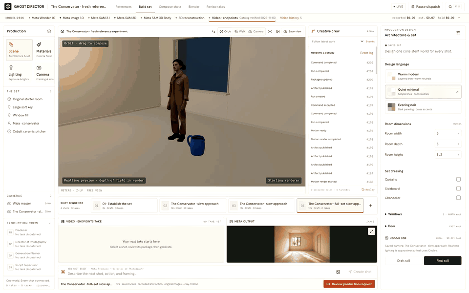
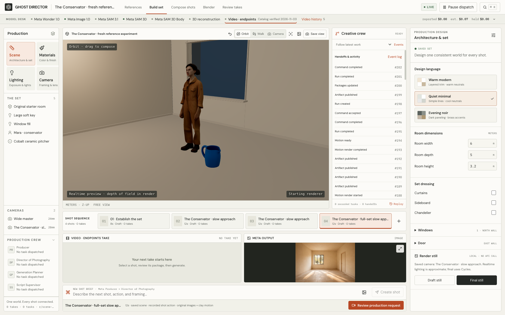
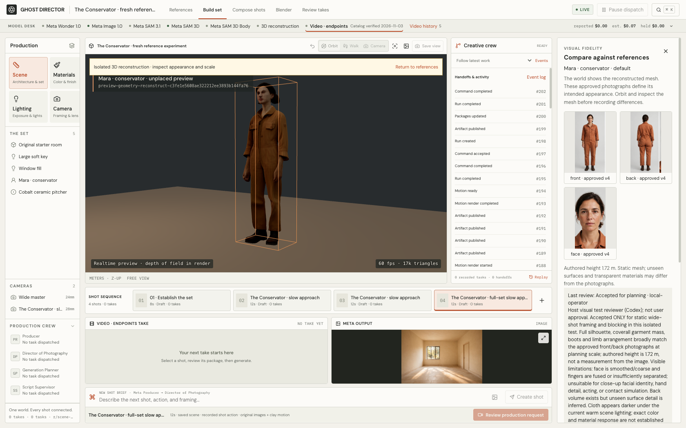
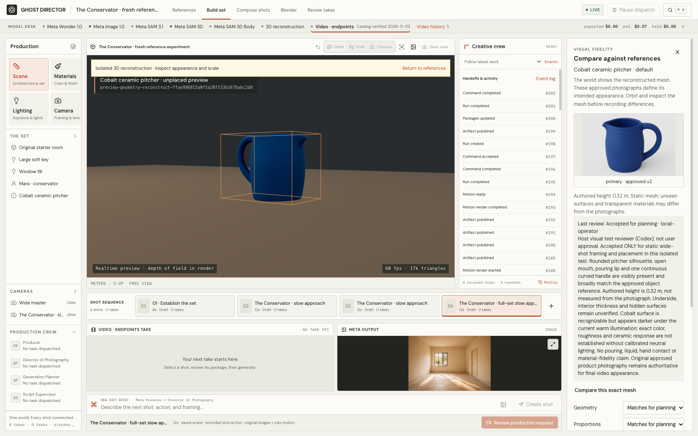
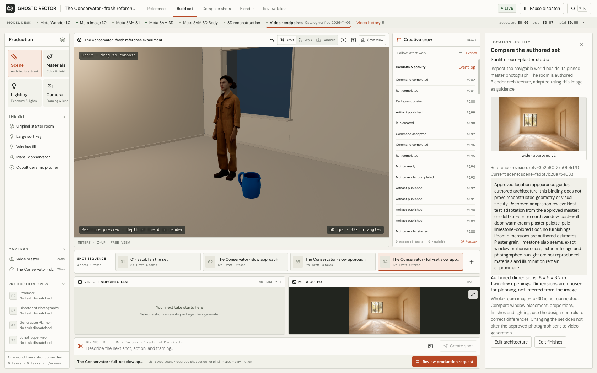
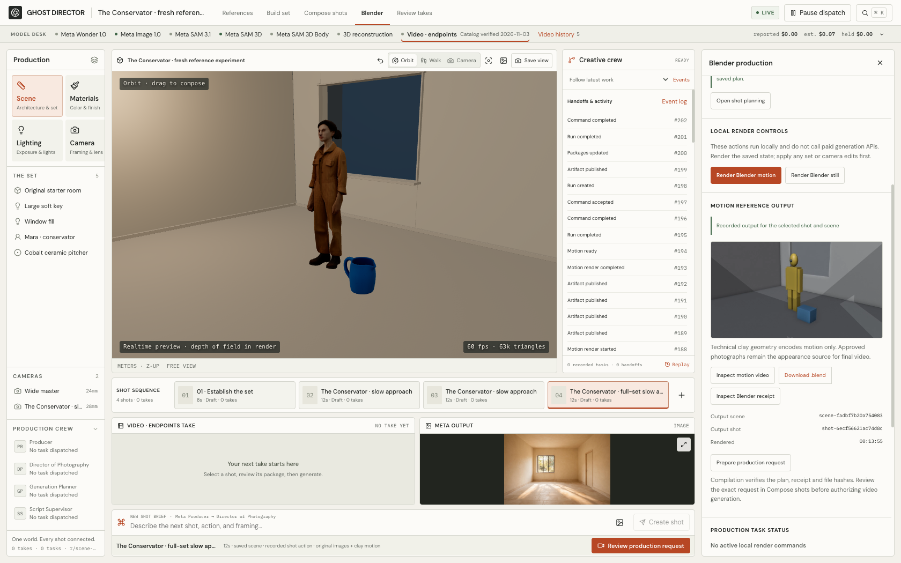
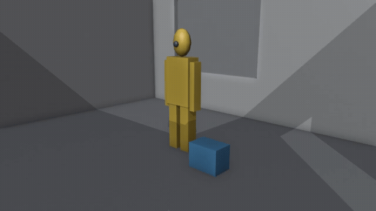
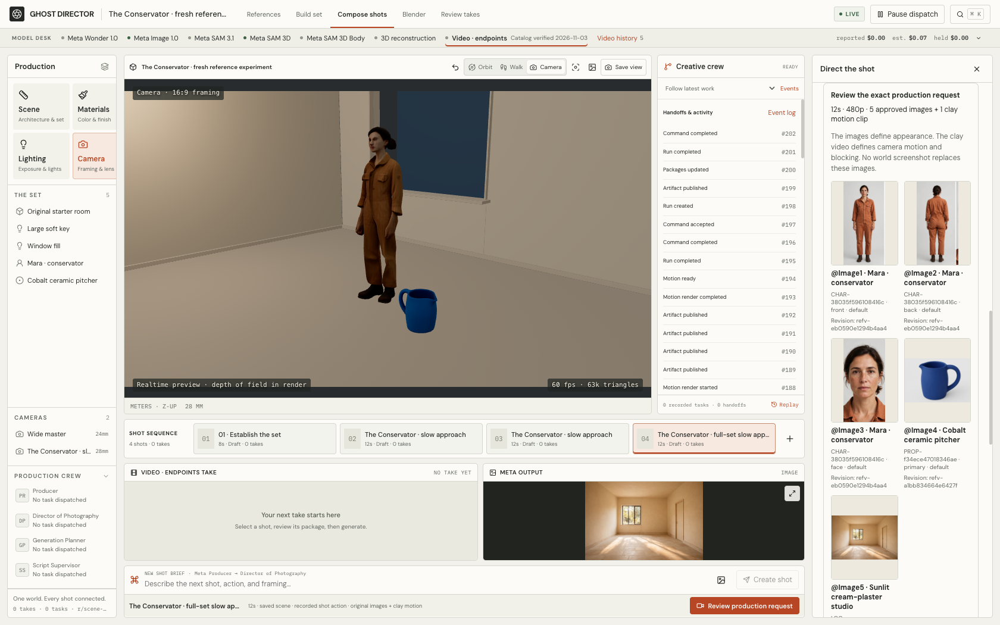
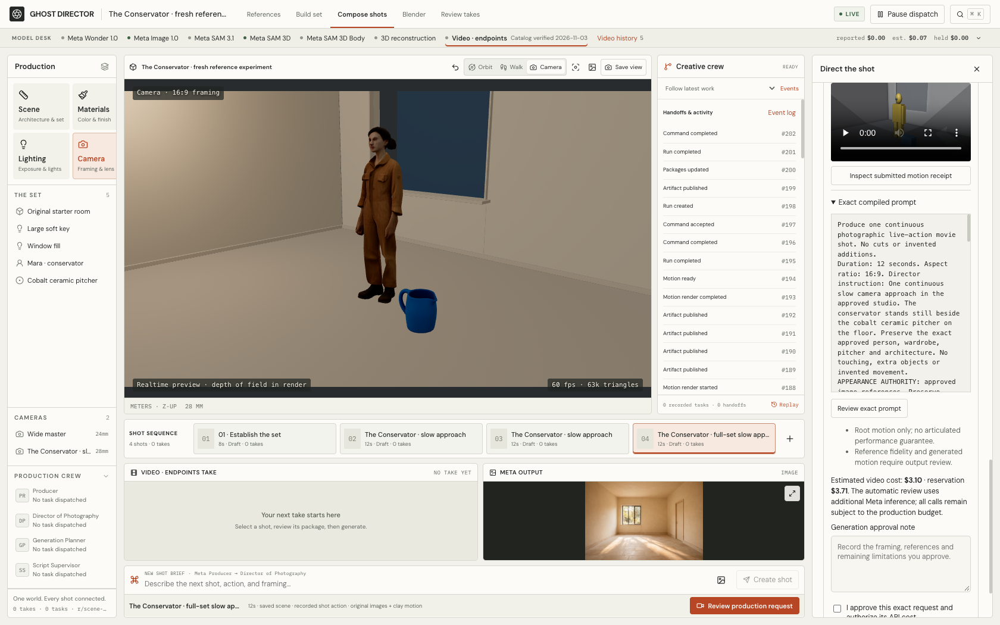

# Ghost Director: a visual tour

These are captures of the working application and its actual outputs, recorded on **November 4, 2026**. The current example, **The Conservator**, follows three newly generated visual references through mesh reconstruction, placement, Blender motion and production-request review. It has **no generated final film**. An earlier prop-only film appears separately at the end.

The preview accelerates the full 65-second recording by **4.5×**. [Watch or download the original 65-second, silent MP4](media/workspace-walkthrough.mp4) for readable controls and real-time navigation. The recording inspects completed work; its duration is not the time required to generate images, reconstruct meshes or render a movie. No new generation is demonstrated by the accelerated playback.

For embedded video players and a larger presentation, open the [standalone visual report](showcase/index.html). GitHub displays that HTML as source rather than running it. Clone or download this repository, keep `docs/showcase` and `docs/media` together, and open `docs/showcase/index.html` locally. The report needs no API keys or application server. To use the application itself, follow the [quick start](../README.md#quick-start).

## Recording chapters

| Time in the original MP4 | What to inspect |
| --- | --- |
| 00:00–00:06 | The saved 3D set and placed character/prop |
| 00:06–00:14 | Character mesh beside approved photographs and review notes |
| 00:14–00:22 | Prop mesh, approved photograph and recorded limitations |
| 00:22–00:30 | Location reference beside the authored room |
| 00:30–00:45 | Blender workflow and actual motion output |
| 00:45–00:55 | The five approved image inputs in the production request |
| 00:55–01:05 | The attached motion clip, exact prompt and approval controls |

## 1. Inspect the saved world

The **Build set** workspace contains Mara, a fictional adult conservator, and a cobalt ceramic pitcher in a small authored room. The world can be navigated and its dimensions, materials, lighting, windows and door edited through the existing controls. The room is 6 × 5 × 3.2 meters; those are authored dimensions, not measurements recovered from the photograph.

The visible mesh assets came from real hosted Meta SAM 3D Objects requests. Their scale was normalized locally to chosen heights of 1.72 meters and 0.32 meters. They are static planning assets. The viewport is neither the approved photographic reference nor a finished movie frame.

The **Creative crew** column shows persisted application events alongside the world. In this particular fresh production, the role-task and handoff counts are zero: the visible events document local commands, renders and package creation. This recording does not claim an agent conversation occurred in this test. The application's role prompts, outputs and handoffs are inspectable when actual role tasks have been run.

## 2. Compare the character with its references

**Compare in world** isolates the reconstructed mesh in the existing canvas while displaying its approved photographs. The operator can inspect geometry, proportions, materials, colors and identity, then record a review before placement. The comparison preview does not alter the saved set.

Mara's front, back and face images were cropped from one newly generated Meta image sheet. Only the approved front image conditioned this reconstruction; the back and face images remain comparison and final-video appearance inputs. [Open the full original character sheet](media/reference-character.png).

The recorded acceptance is explicitly limited to **static wide-shot framing and blocking**, attributed to the host test reviewer, not the user's creative approval. The face is coarse, fingers are fused or poorly separated, and clothing looks darker in the scene lighting. Close-up likeness, exact material/color fidelity, articulated acting and hand contact remain unverified. These limitations are visible in the application's review notes.

## 3. Compare and place the prop

The pitcher has its own identity, approved image version, reconstructed mesh and attributed review. Its broad body, opening, lip and handle are recognizable at planning scale. Interior thickness, underside and hidden surfaces are unverified; a plausible silhouette does not establish ceramic material fidelity or support a pouring/contact simulation.

[Open the original prop reference](media/reference-prop.png). The accepted placement retains the exact mesh hash, reference revision and review binding. This links the visible world object to its evidence without silently changing the approved image.

## 4. Compare the location with the authored architecture

The location master guides an editable rectangular set with a north-wall window left of center and an east-wall door. **Compare location in world** shows that master beside the current architecture and its adaptation notes. [Open the original location reference](media/reference-location.png).

This room was adapted with the existing Blender-backed authoring tools; it is **not a whole-room image-to-3D reconstruction**. Plaster grain, limestone seams, detailed window construction, exterior foliage and photographed sunlight remain unmatched. The original image continues to define the intended appearance even where the planning world is approximate.

## 5. Inspect real Blender work

The **Blender** workspace exposes the working local subprocess integration: render controls, task state, output bindings, a playable motion clip, the generated `.blend` file and its validation receipt. Blender MCP is not implemented. A completed output belongs to a particular scene revision and shared shot plan; it is not a decorative preview.

[Play or download the actual 12-second Blender motion MP4](media/conservator-blender-motion.mp4). Its colored proxies express camera movement and blocking. The character and prop remain stationary. The simplified geometry and proxy colors are not appearance inputs for the final film.

The measured output is **640 × 360, 24 FPS, 288 frames**, produced locally in **11.016 seconds** including rendering and encoding. Three sampled Blender channel checks reported maximum absolute error `1.1920928955078125e-7`, below the `1e-4` tolerance. This checks execution of the shared motion plan, not the quality of a future generated movie.

The first camera attempt cropped the floor prop. The corrected path passed 4,624 bounding-box corner projections over 289 sampled times with a 20-pixel image-edge margin. The corrected start, midpoint and end frames were visually inspected and retained both proxies. Those checks do not prove every-frame appearance fidelity or arbitrary occlusion behavior.

## 6. Review the exact production inputs

The prepared request contains **five approved images**: Mara's front, back and face views, the pitcher photograph, and the location master. The reference mapping exposes the exact inputs and approved revisions. No screenshot of the 3D world replaces these photographs.

The same review shows the actual Blender MP4, matching motion receipt, exact compiled prompt and cost estimate. The package has no missing appearance-binding warnings. That is evidence of input coverage; it is not a prediction that a video model will preserve every detail.

**The request is compiled, not approved or dispatched.** The screenshot retains the unchecked approval control. The recorded future video estimate is approximately **$3.095**, with a **$3.714 prospective reservation (not held)**, outside the fresh experiment's $1 authorization. The experiment's actual application-ledger estimate remains **$0.07** for three image requests and two reconstruction requests. These figures are estimates rather than audited provider invoices.

The exact corrected lineage is scene `scene-fadbf7b20a754083`, shot `shot-6ecf56621ac74d8c`, motion `motion-aebba79e64a84220`, and package `package-3f6d54831d6942e3`. See the [dated experiment record](FRESH-EXPERIMENT.md) for the implementation and browser-verification evidence.

## Earlier experiment: an actual generated prop film

[Play or download the earlier 4.04-second film](media/earlier-bottle-film.mp4) · [Inspect its approved bottle reference](media/earlier-bottle-reference.png)

This **November 3 experiment is separate from The Conservator**. It used a Meta-created, unbranded amber-bottle photograph and an actual Blender motion reference to produce a real generated video. A separate video renderer produced the film; Meta generated its appearance reference and reconstructed planning asset. The output is 854 × 480 H.264 at 24 FPS, 97 frames, with no audio. Its published MP4 is byte-identical to the recorded output artifact.

The clip demonstrates the earlier **prop-only reference-plus-motion path**. Only the bottle had an approved appearance reference; eight inherited room/furnishing entities had missing-reference warnings. The photograph was approved by the build evaluator for that bounded experiment, and the generated take remains **reviewed but unaccepted**. Reflections and perceived shape vary. Exact geometry, metric camera-path adherence, full-scene fidelity and continuous identity stability are unverified.

The retained take is `take-b25217869f1c45ca`, from package `package-c8b280dc113541d7`. It must not be presented as a Conservator output, a director-approved commercial, or proof of production-ready humans.

## What this tour establishes

The captures show accessible reference comparison, reviewed static mesh placement, editable planning architecture, a real Blender output and an inspectable production request in the existing web application. The fresh workflow stops before paid final-video dispatch. Character performance, calibrated materials, automatic room reconstruction and final cinematic fidelity remain unresolved.

The media is a curated evidence selection, not a portable production database. A fresh installation starts with an empty procedural set; these screenshots and recordings do not populate that application. File hashes, media transformations and source identities are recorded in the [media manifest](media/manifest.json). Generated media has separate terms from the MIT-licensed source code; see [source and media provenance](PROVENANCE.md).
